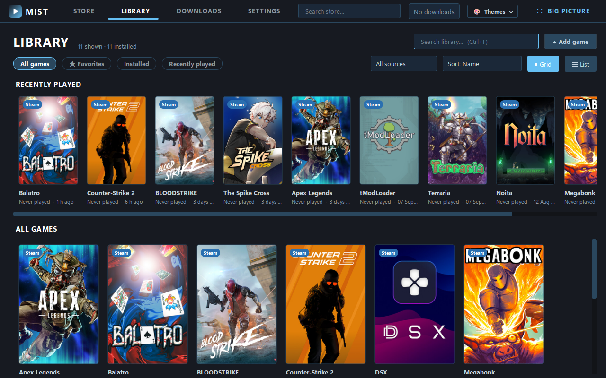
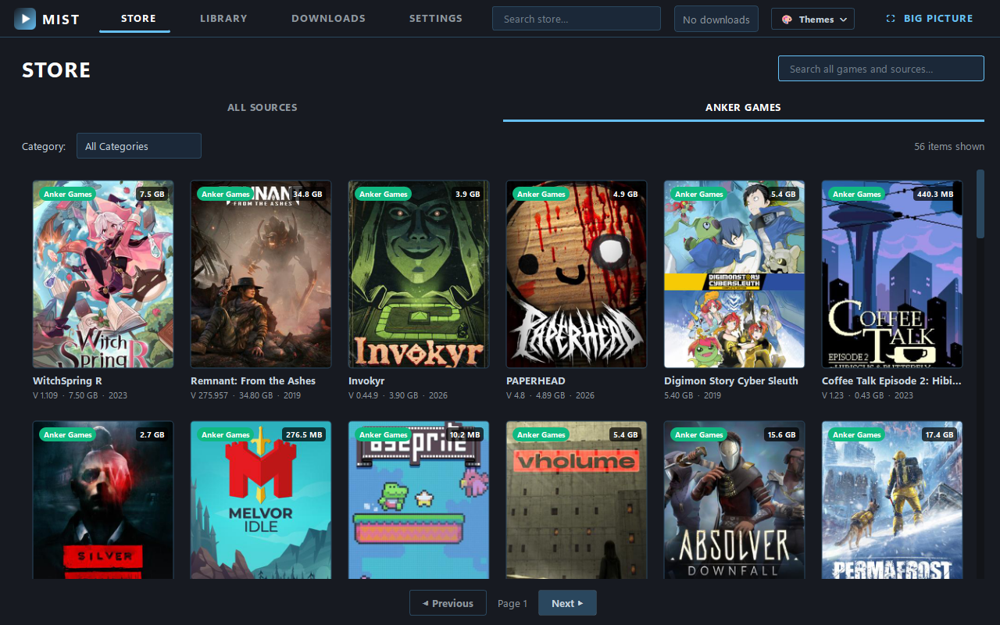
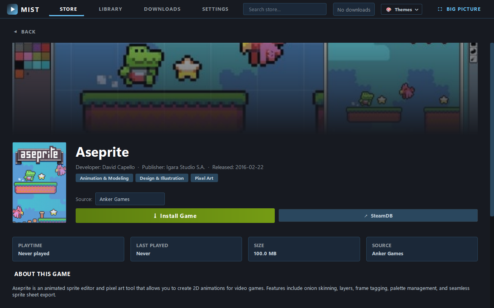
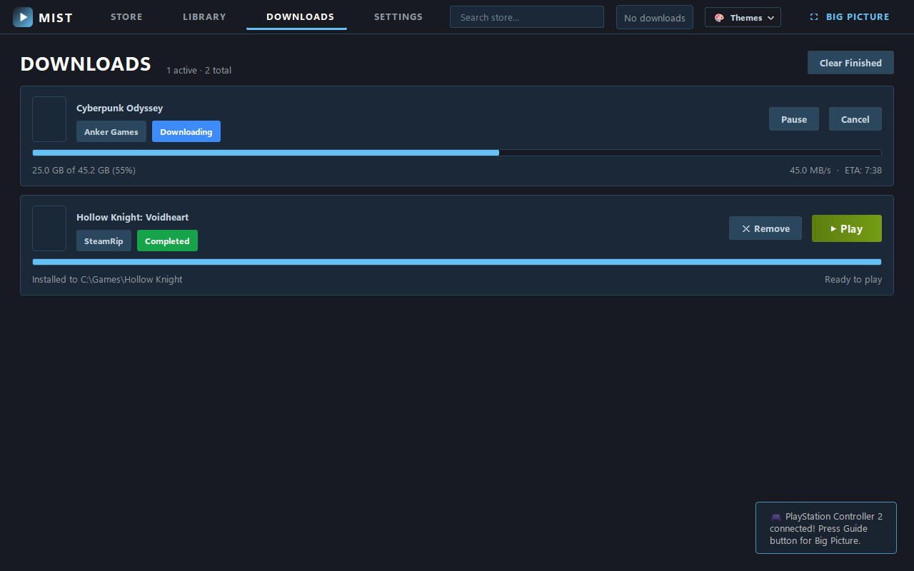
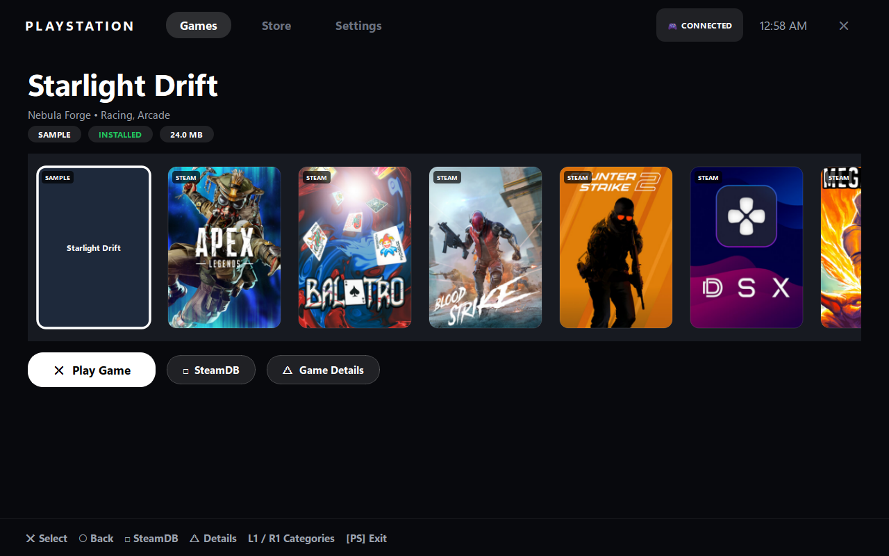
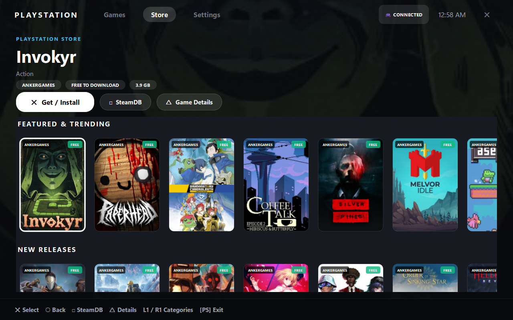
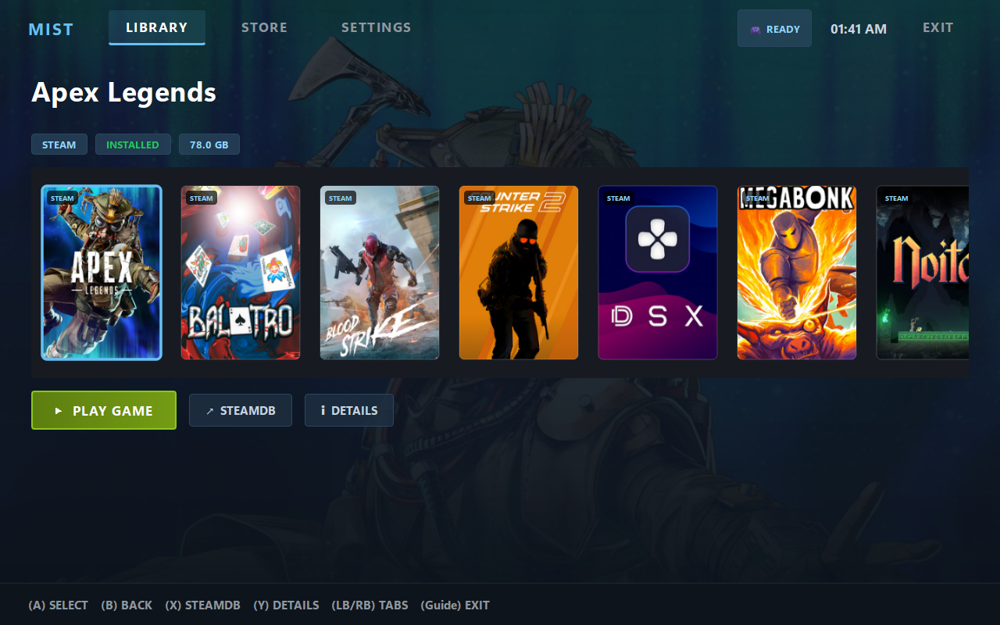
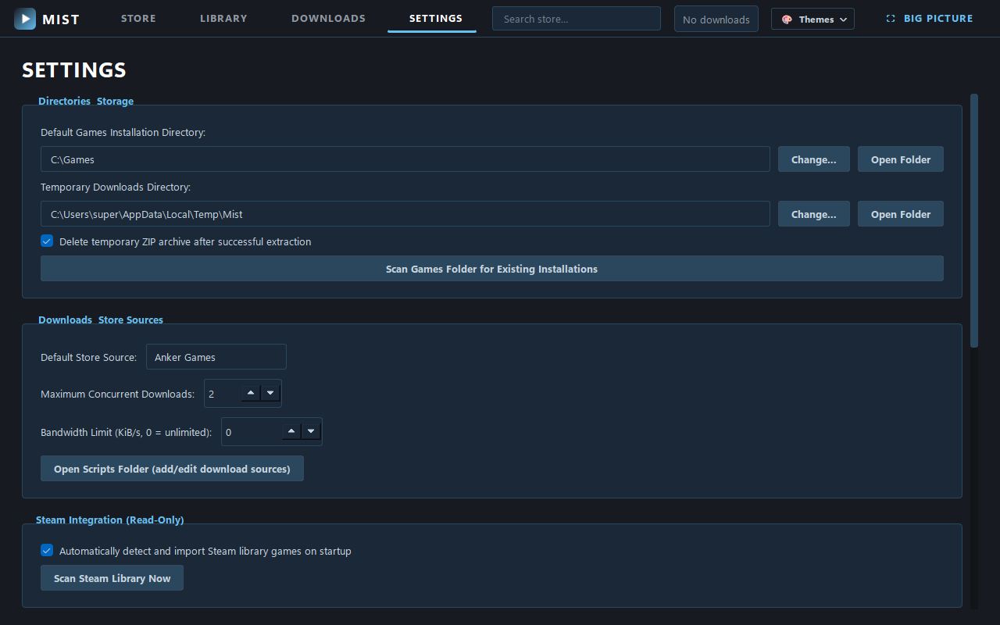
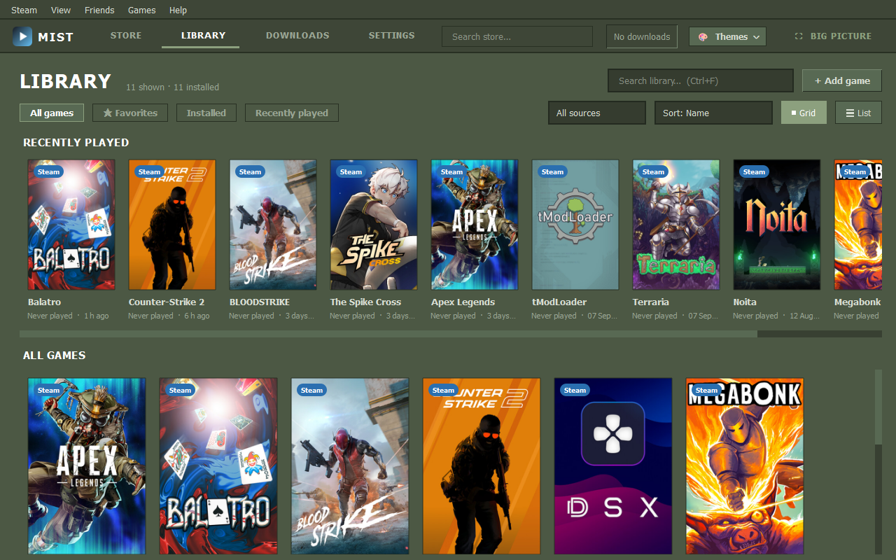
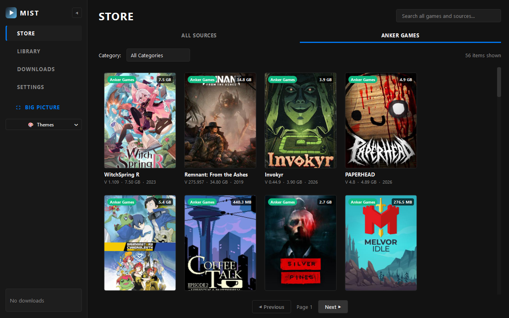

<div align="center">

# 🎮 Mist

**A modern, ultra-lightweight unified desktop game library manager and gamepad launcher.**

[](https://www.python.org/)
[](https://www.qt.io/)
[](https://www.microsoft.com/)
[](#-privacy-first)
[](LICENSE)

*Browse, download, manage, and launch your games across multiple sources from a single polished client.*

[Features](#-key-features) • [Screenshots](#-interface-showcase) • [Installation](#-getting-started) • [Repository Structure](#-repository-structure) • [Gamepad Support](#-gamepad--big-picture-mode) • [Themes](#-theme--layout-presets)

</div>

---

## 📸 Interface Showcase

### 1. Library & Store Experience
| Game Library (Steam Modern) | Multi-Source Store Catalog |
|:---:|:---:|
|  |  |

### 2. Game Details & Download Pipeline
| Detailed Game Page & SteamDB | Downloads & Extraction Queue |
|:---:|:---:|
|  |  |

### 3. Fullscreen Big Picture Mode
| PlayStation 5 inspired Console Style (Library) | PlayStation Store Shelves |
|:---:|:---:|
|  |  |

| Steam Classic Big Picture Style | Settings & Theme Customizer |
|:---:|:---:|
|  |  |

### 4. Layout & Theme Presets
| Classic Steam (2003 / Retro Green with Menu Bar) | Epic / Sidebar Modern (Collapsible Drawer) |
|:---:|:---:|
|  |  |

---

## ✨ Key Features

- **📚 Unified Game Library**
  - Instant grid and list views with dynamic search filtering.
  - Automatic detection and import of local Steam games (read-only `appmanifest_*.acf` parsing).
  - Playtime tracker, last played timestamping, and custom executable configuration.
  - One-click launch with game process monitoring.

- **🛒 Multi-Source Store Catalog**
  - Unified catalog discovery aggregating **Anker Games** and **SteamRip**.
  - Search by game title or filter by genre and download source.
  - Clean cover art cards with size badges, source badges, and instant details navigation.

- **📄 Rich Game Detail Pages**
  - High-resolution hero banner and cover art presentation.
  - System hardware specifications (CPU, RAM, GPU, OS).
  - Direct **↗ SteamDB** lookup integration for community ratings, patches, and price history.
  - Multi-provider install modal allowing users to select mirror sources and custom target directories.

- **⚡ Robust Download & Install Pipeline**
  - Multi-threaded asynchronous downloader with speed calculations, ETA estimations, pause/resume, and cancellation.
  - Automated safe extraction pipeline with built-in fallback for Zstandard, Deflate64, and 7-Zip archives (`tar.exe` / `7z.exe`).
  - Path traversal and zip-slip protection.
  - Automatic staging verification and cleanup of temporary archives upon successful installation.
  - Configurable bandwidth throttling and concurrent download limits.

- **🎮 Gamepad & Big Picture Mode**
  - Zero-dependency background polling utilizing Windows native `XInput` and `WinMM` (DirectInput).
  - Press the **Guide / Xbox / PS button** (or Back + Start chord) anywhere to toggle Big Picture mode.
  - Two distinct Big Picture visual styles:
    - **Classic**: Authentic Steam Big Picture aesthetic with dark navy gradient cards and Steam controller glyphs (`[A]`, `[B]`, `[X]`, `[Y]`).
    - **Console**: Sleek obsidian PlayStation 5 inspired UI with dynamic hero wallpapers and authentic PS glyphs (`✕`, `○`, `□`, `△`).
  - Built-in **PlayStation Store** inspired browsing experience featuring *Featured & Trending*, *New Releases*, *Anker Games*, and *SteamRip* shelves.

- **🎨 Themes & Layout Presets**
  - **Steam Modern** (Default): Authentic dark Steam palette (`#171a21`, `#1b2838`) with top navigation tabs.
  - **Classic Steam (2003 / Retro Green)**: Vintage Valve olive-green styling (`#4c5844`), square bevels, and authentic nostalgic menu bar (`Steam`, `View`, `Friends`, `Games`, `Help`).
  - **Epic / Sidebar Modern**: Obsidian dark aesthetic with a collapsible left vertical navigation drawer (full 220px drawer vs 64px compact icon rail).
  - **GOG Galaxy / Cyber Minimalist**: Cyberpunk neon violet palette (`#8b5cf6`), pill-shaped category chips, and top integrated quick search.
  - **Clean Light**: Daylight aesthetic with high-contrast text and clean blue accents.
  - 1-click Quick Theme Switcher in the top bar and live preview swatches in Settings.

- **🛡️ Privacy-First**
  - 100% local SQLite database.
  - Zero telemetry, zero analytics, zero external user accounts.
  - Silent headless browser automation without popups or sync prompts.

---

## 📁 Repository Structure

```text
mist/
├── Assets/                 <-- Icons, placeholders, and UI screenshots
│   ├── icon.ico
│   ├── icon.png
│   └── screenshots/        <-- All 10 high-resolution feature screenshots
│       ├── 01_library_view.png
│       ├── 02_store_view.png
│       ├── 03_detail_view.png
│       ├── 04_downloads_view.png
│       ├── 05_settings_view.png
│       ├── 06_big_picture_console.png
│       ├── 07_big_picture_ps_store.png
│       ├── 08_big_picture_classic.png
│       ├── 09_classic_2003_theme.png
│       └── 10_epic_sidebar_theme.png
├── Core/                   <-- Backend engines
│   ├── config.py           <-- Settings manager & theme migrations
│   ├── controller.py       <-- XInput & WinMM gamepad driver
│   ├── database.py         <-- SQLite library storage
│   ├── downloader.py       <-- Asynchronous download manager
│   ├── extractor.py        <-- Safe archive extraction & tar/7z fallback
│   ├── images.py           <-- Asynchronous disk-cached image loader
│   ├── launcher.py         <-- Game executable detection & process tracker
│   ├── library.py          <-- Library management & Steam import
│   ├── logger.py           <-- Structured logging
│   ├── paths.py            <-- Application directories
│   ├── sources.py          <-- Catalog source interfaces & registry
│   └── steam_scanner.py    <-- Steam appmanifest ACF reader
├── Scripts/                <-- Store plugins & resolvers
│   ├── catalogs/           <-- Local JSON catalog definitions
│   ├── ankergames.py       <-- Anker Games catalog & CDP resolver
│   ├── json_catalog_source.py
│   └── steamrip.py         <-- SteamRip catalog & mirror resolver
├── UI/                     <-- Qt interface components
│   ├── actions.py          <-- Common UI actions & dialogs
│   ├── big_picture.py      <-- Fullscreen Big Picture (Steam + PS5 styles)
│   ├── common.py           <-- Common widgets, badges & async runners
│   ├── context.py          <-- AppContext dependency injection
│   ├── detail_view.py      <-- Game details & SteamDB action bar
│   ├── downloads_view.py   <-- Downloads monitor & progress cards
│   ├── library_view.py     <-- Game library grid & list delegates
│   ├── main_window.py      <-- Adaptive layout window (Top Nav / Sidebar)
│   ├── settings_view.py    <-- Appearance & directory preferences
│   ├── store_view.py       <-- Store catalog & card delegates
│   ├── theme.py            <-- CSS stylesheets, palettes & presets
│   └── wizard.py           <-- First-run configuration wizard
├── .gitignore              <-- Excludes caches, temporary downloads, and databases
├── config.json             <-- Default user settings (Steam Modern preset)
├── LICENSE                 <-- Apache License 2.0
├── main.py                 <-- Application entry point
├── README.md               <-- Documentation & showcase
├── requirements.txt        <-- Only PySide6 is required!
└── test_full_suite.py      <-- Automated integration test suite (57 tests)
```

### 🚫 Files Ignored by `.gitignore` (Automatically Excluded)
These folders are generated dynamically at runtime and are automatically excluded:
- `cache/` — Image thumbnail disk caches (downloaded dynamically).
- `temp/` — Temporary download staging folder and active zip archives.
- `data/` — Local SQLite user database (`library.db`).
- `logs/` — Runtime log files (`mist.log`, `opensteam.log`).
- `__pycache__/` — Python bytecode cache (`.pyc`).

---

## 🚀 Getting Started

### Prerequisites
- **Operating System**: Windows 10 or Windows 11 (64-bit)
- **Python**: Python 3.10, 3.11, 3.12, or 3.13

### Installation

1. **Clone the repository**:
   ```bash
   git clone https://github.com/pineapplemanxd/mist.git
   cd mist
   ```

2. **Create a virtual environment (optional but recommended)**:
   ```bash
   python -m venv .venv
   .venv\Scripts\activate
   ```

3. **Install the single required dependency**:
   ```bash
   pip install -r requirements.txt
   ```
   *(Mist is built with pure Python and Qt — `PySide6` is the only external package needed!)*

4. **Launch Mist**:
   ```bash
   python main.py
   ```

---

## 📦 Compiling to Standalone Executable (.exe)

You can compile Mist into a standalone Windows executable using PyInstaller:

1. Install PyInstaller:
   ```bash
   pip install pyinstaller
   ```

2. Compile Mist into a self-contained windowed application:
   ```bash
   pyinstaller --noconsole --name "Mist" --icon "Assets/icon.ico" --add-data "Assets;Assets" --add-data "Scripts;Scripts" main.py
   ```

3. Your standalone executable will be located in `dist/Mist/Mist.exe`.

---

## 🕹️ Gamepad & Keyboard Shortcuts

### Gamepad Controls (Xbox / DualShock / DualSense)
| Button (Xbox) | Button (PlayStation) | Action |
|:---:|:---:|:---|
| **Guide / Xbox** | **PS Button** | Toggle Big Picture Mode |
| **Back + Start** | **Share + Options** | Toggle Big Picture Mode (Alternative Chord) |
| **D-Pad / Left Stick** | **D-Pad / Left Stick** | Navigate Cards, Shelves, and Tabs |
| **A** | **✕ (Cross)** | Select / Play Game / Install |
| **B** | **○ (Circle)** | Back / Return to Carousel |
| **X** | **□ (Square)** | Open Game on SteamDB |
| **Y** | **△ (Triangle)** | Open Game Details Modal |

### Keyboard Shortcuts
| Key | Action |
|:---:|:---|
| `Arrow Keys` | Move Focus Left / Right / Up / Down |
| `Enter` / `Space` | Select / Play Game / Install |
| `Escape` / `Backspace` | Back / Exit Big Picture Modal |
| `X` | Open SteamDB in default browser |
| `D` or `I` | Open Game Details modal |

---

## 🧪 Testing & Verification

Mist includes a complete automated test suite covering all modules:
```bash
python test_full_suite.py
```
*(All 57 unit and integration tests execute in headless mode, verifying source scraping, extraction safety, controller isolation, layout switching, and theme compilation).*

---

## 📄 License

This project is released under the **Apache License 2.0**. See [LICENSE](LICENSE) for details.
